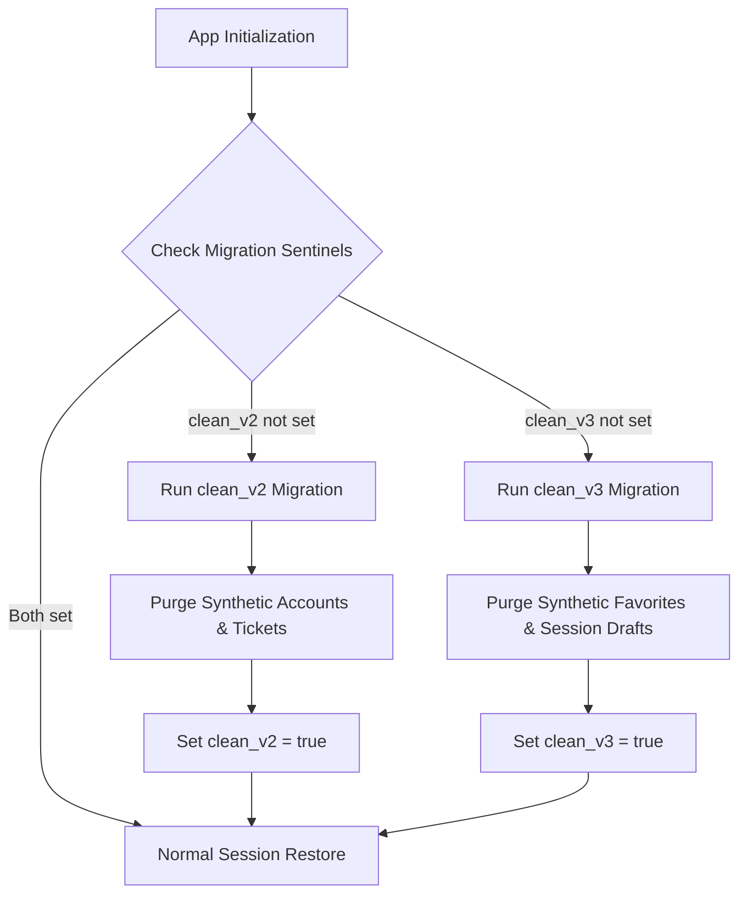

# RailConnect — Digital Commuter Rail Ticketing Prototype

[](https://react.dev/)
[](https://www.typescriptlang.org/)
[](https://tanstack.com/start)
[](https://tailwindcss.com/)
[](https://railconnect-frontend-psi.vercel.app/)

> [!IMPORTANT]
> **PROTOTYPE & NON-AFFILIATION NOTICE**
>
> **RailConnect is an independent, frontend-focused demonstration prototype** inspired by commuter and unreserved railway ticketing workflows (such as Mumbai Suburban Western and Central railway corridors).
>
> RailConnect is **not** an official application of Indian Railways, the Centre for Railway Information Systems (CRIS), the Indian Railway Catering and Tourism Corporation (IRCTC), the UTS on Mobile application, or RailOne. It does **not** claim any government affiliation, official railway authorization, or production backend integration. There is currently **no live backend database, real production API, actual railway ticket issuance, or live payment/banking processing**. All tickets, drafts, payment methods, and account states shown in this application are for frontend prototype and interface evaluation purposes only.

---

## Live Demo & Repository

- **Live Demo:** [https://railconnect-frontend-psi.vercel.app/](https://railconnect-frontend-psi.vercel.app/)
- **GitHub Repository:** [https://github.com/MuraliOnline-web/RailConnect](https://github.com/MuraliOnline-web/RailConnect)
- **Target Branch:** `main`

---

## Table of Contents

1. [Project Overview](#project-overview)
2. [Feature Inventory](#feature-inventory)
3. [Truthful Prototype Limitations](#truthful-prototype-limitations)
4. [Technology Stack](#technology-stack)
5. [Complete Project Folder Structure](#complete-project-folder-structure)
6. [Installation & Development Commands](#installation--development-commands)
7. [Deployment Architecture](#deployment-architecture)
8. [Storage & Data-Cleanup Architecture](#storage--data-cleanup-architecture)
9. [Testing & Verification Status](#testing--verification-status)

---

## Project Overview

RailConnect explores modern web patterns for suburban and commuter rail ticketing. In high-density commuter rail networks, passengers require ultra-fast ticket booking, platform ticket access, quick station lookup, fare calculation, paperless digital QR presentation, and printable receipts without navigating cumbersome multi-step booking funnels.

RailConnect addresses these workflows through a responsive, high-performance web interface built with **React 19**, **TanStack Start (SSR)**, **TanStack Router**, and **Tailwind CSS v4**, featuring full dark mode support, multi-language internationalization, accessible contrast standards, and truthful state management.

---

## Feature Inventory

### 1. Public & Informational Pages
- **Landing Page (`/`):** Dynamic hero presentation, quick suburban booking selector, feature highlights, and suburban network highlights.
- **Why RailConnect (`/why`):** Benefits overview highlighting queue-free suburban commuting, digital passes, accessibility, and paperless ticketing.
- **Network Map (`/network`):** Interactive overview of the Western and Central suburban railway corridors, key terminus stations, interchange junctions, and route lines.
- **About (`/about`):** Project manifesto, architectural foundations, engineering principles, and prototype disclaimers.

### 2. Authentication & User Management
- **Sign In (`/login`):** Validated login form, demo mode shortcut, session restore, secure authentication presentation, and password visibility toggling.
- **Sign Up (`/register`):** User registration with full name, mobile number, email, and password complexity validation.
- **Password Requirements (`PasswordRequirements.tsx`):** Real-time visual strength meter verifying minimum 8 characters, uppercase and lowercase letters, numeric digits, and special characters.
- **Session Activity (`/dashboard/profile/login-activity`):** Real-time session monitoring displaying client device type, detected IP, active timestamp, browser user-agent, and session termination options.

### 3. Dashboard Hub
- **Unified Dashboard (`/dashboard`):** Commuter dashboard with quick-action shortcuts (Journey, Platform, QR Ticket), animated metric counters (`Counter.tsx`), recent transactions, active pass status, and suburban alert bulletins.

### 4. Journey Ticket & Station Search
- **Journey Booking (`/dashboard/journey` & `/dashboard/book`):** Station search autocomplete (`StationSearch.tsx`, `SearchField.tsx`) pre-loaded with suburban railway reference stations (Churchgate, Dadar, Bandra, Andheri, Borivali, Virar, CSMT, Thane, Kalyan, etc.).
- **Ticket Types:** Single Journey, Return Journey, and Season Pass (Monthly / Quarterly).
- **Class Categories:** Second Class (Ordinary), First Class, and AC Local.
- **Passenger Count:** Configurable adult and child passenger selections with dynamic fare updates.

### 5. Platform Ticket Flow
- **Platform Ticket (`/dashboard/platform`):** Station selector, passenger counter, flat suburban platform fare (₹10/passenger), and countdown validity timer (valid for 2 hours from issue draft).

### 6. Payment & Checkout Presentation
- **Payment Gateway Interface (`/dashboard/payment`):** Multi-method selector featuring official branded vector assets (`PaymentMethodLogo.tsx`):
  - **UPI:** Google Pay, PhonePe, Paytm, BHIM UPI, and custom UPI ID
  - **Wallets:** RailConnect R-Wallet, Paytm Wallet
  - **Cards & Banking:** Visa, Mastercard, American Express, RuPay, Debit/Credit Cards, Net Banking
- **Pending-Gateway Disclaimer:** Transparent notice informing users that payment gateway integration is currently pending; payment drafts remain simulated and do not trigger financial charges.
- **Checkout Abandonment Guard:** Safe navigation away from checkout preserves or cleanly resets temporary payment drafts without corrupting settled balances.

### 7. Ticket Management, QR & PDF Presentation
- **Ticket Management (`/dashboard/tickets`):** Filter tickets by Active, Expired, and Past states.
- **Ticket Details (`/dashboard/ticket`):** Dedicated ticket inspection screen displaying PNR, origin/destination codes, route path, validity window, fare breakdown, and manual PDF download.
- **Digital QR Gate Ticket (`/dashboard/qr`):** High-contrast dynamic QR gate presentation formatted for optical suburban ticket turnstiles and handheld conductor scanners.
- **Printable PDF Ticket Generation (`ticketPdf.ts`):** Client-side A4 document generator powered by `jsPDF` producing formatted passenger coupons, QR codes, fare receipts, and travel guidelines.

### 8. Financial Ledger, Wallet & Refunds
- **Wallet Hub (`/dashboard/wallet`):** Available balance display, quick top-up denominations (₹100, ₹200, ₹500, ₹1000), simulated payment method selection, and truthful pending-banking notices.
- **Recharge Confirmation (`/dashboard/wallet-recharge-success`):** Digital recharge draft voucher showing transaction reference, amount, and payment channel.
- **Transaction History (`/dashboard/transactions`):** Detailed ledger logging ticket purchases, wallet recharges, and pending adjustments.
- **Refunds & Cancellations (`/dashboard/refunds`):** Ticket cancellation request interface with refund rules and honest notices that monetary settlement requires authoritative backend processing.
- **Refund Confirmation (`/dashboard/refund-success`):** Processed refund claim receipt.

### 9. Favorites & Notifications
- **Favorite Routes (`/dashboard/favorites`):** Save frequent commutes (e.g. Churchgate ↔ Dadar) for one-tap booking prefill.
- **Notification Center (`/dashboard/notifications`):** Operational rail alerts, track maintenance bulletins, schedule updates, unread badge counter (`NotificationBell.tsx`), and one-click "Mark all as read".

### 10. Profile Subroutes & Account Customization
- **Profile Overview (`/dashboard/profile`):** User summary, security badge, quick links to profile subroutes, and commuter settings.
- **Edit Profile (`/dashboard/profile/edit`):** Dedicated subroute with `ProfileEditForm.tsx` to update commuter name, email address, and mobile number.
- **Change Password (`/dashboard/profile/change-password`):** Dedicated subroute with `ChangePasswordForm.tsx` verifying current password before applying new credentials with complexity enforcement.

### 11. Internationalization (i18n) & Accessibility
- **Multi-Language Support (`i18n.tsx`):** Complete language selector supporting 7 Indian languages:
  - English (`en`)
  - Hindi (`hi`)
  - Marathi (`mr`)
  - Gujarati (`gu`)
  - Telugu (`te`)
  - Tamil (`ta`)
  - Bengali (`bn`)
- **Theme & Accessibility:**
  - High-contrast Dark Mode and Light Mode with CSS custom properties (`src/styles.css`).
  - Reduced Motion support respecting `prefers-reduced-motion` and user settings.
  - Large Text mode for improved commuter readability.
  - Per-account preference persistence in browser storage.

---

## Truthful Prototype Limitations

To maintain strict truthfulness and integrity, the application enforces the following operational boundaries:

1. **Client-Side Storage Only:** Authentication, profile data, tickets, wallet balances, and preferences are stored exclusively in the browser's `localStorage` and `sessionStorage`. There is no cloud database or server-side session store.
2. **Credential Safety:** Users must **never** enter real personal, banking, or sensitive passwords into this prototype.
3. **No Railway Service Connection:** RailConnect is **not** integrated with CRIS, IRCTC, or Indian Railways reservation engines. Displayed tickets, PNRs, or platform coupons **do not constitute valid travel authority** on any public or private train.
4. **No Financial Mutations:** Payment gateways and banking APIs are not connected. The application will not debit bank accounts, process credit cards, alter real wallet balances, or disburse monetary refunds. All success states are clearly labeled as frontend drafts.
5. **Static Station Catalogue:** The pre-populated suburban stations (Western and Central Mumbai suburban lines) serve as application reference data. They are not live railway feeds.

---

## Technology Stack

The application relies on modern TypeScript and React ecosystem libraries:

| Layer / Role | Technology | Version | Purpose |
|---|---|:---:|---|
| **Frontend Framework** | React | `^19.2.0` | Declarative UI and component hierarchy |
| **Language** | TypeScript | `^5.8.3` | Type safety and static analysis |
| **Routing & SSR** | TanStack Start | `^1.167.50` | Full-stack SSR and server functions |
| **Client Routing** | TanStack Router | `^1.168.25` | Type-safe declarative client routing |
| **Build Tooling** | Vite | `^7.3.1` | Ultra-fast HMR and bundle compilation |
| **Vite Config Wrapper** | `@lovable.dev/vite-tanstack-config` | `2.8.5` | Standardized TanStack Start Vite preset |
| **Server Engine** | Nitro | `3.0.260603-beta` | Universal deployment engine & serverless adapter |
| **Styling** | Tailwind CSS | `^4.2.1` | Utility-first responsive design & dark mode |
| **Animations** | Framer Motion | `^12.40.0` | Smooth UI transitions and micro-interactions |
| **UI Primitives** | Radix UI | Various | Accessible dialogs, popovers, tabs, and selects |
| **Icons** | Lucide React | `^0.575.0` | Modern, consistent iconography |
| **PDF Generation** | jsPDF / html2canvas | `^4.2.1` | Client-side A4 ticket and receipt rendering |
| **Form Management** | React Hook Form & Zod | `^7.71.2` / `^3.24.2` | Schema-driven form validation |
| **Toasts** | Sonner | `^2.0.7` | Accessible floating notification alerts |

---

## Complete Project Folder Structure

The repository is structured with the Git root at `C:\UTS` and the full web application under `Frontend/`:

```text
C:\UTS/
├── .agents/
│   └── rules/                               # Architectural rules & invariants
│       ├── cdp-browser-automation-invariants.md
│       ├── dark-mode-contrast-and-modal-audit.md
│       ├── responsive-balanced-cards.md
│       ├── storage-migration-and-prototype-truthfulness.md
│       ├── tanstack_router_transitions.md
│       ├── ticket-ui-invariants.md
│       ├── truthful-security-and-subroutes.md
│       └── ui-design-system-invariants.md
├── Frontend/                                # Application root
│   ├── public/
│   │   └── images/
│   │       └── payment-brands/              # Branded SVG/PNG payment vector assets
│   │           ├── amex.svg
│   │           ├── bhim.svg
│   │           ├── bhim-mark.svg
│   │           ├── google-g.svg
│   │           ├── google-pay.svg
│   │           ├── google-pay-circular.png
│   │           ├── mastercard.svg
│   │           ├── paytm.svg
│   │           ├── paytm-wallet-circular.png
│   │           ├── phonepe.svg
│   │           ├── upi.svg
│   │           └── visa.svg
│   ├── src/
│   │   ├── components/                      # Modular application components
│   │   │   ├── ui/                          # Radix UI styled wrappers
│   │   │   │   ├── alert-dialog.tsx
│   │   │   │   ├── button.tsx
│   │   │   │   ├── dialog.tsx
│   │   │   │   ├── input.tsx
│   │   │   │   ├── popover.tsx
│   │   │   │   ├── select.tsx
│   │   │   │   ├── tabs.tsx
│   │   │   │   └── tooltip.tsx
│   │   │   ├── AuthShell.tsx                # Authentication card wrapper layout
│   │   │   ├── ChangePasswordForm.tsx       # Password modification form
│   │   │   ├── Counter.tsx                  # Animated numeric metric counters
│   │   │   ├── DashboardShell.tsx           # Dashboard layout, sidebar & navigation
│   │   │   ├── LoginActivityContent.tsx     # Session activity and device inspector
│   │   │   ├── NotificationBell.tsx         # Notification badge & popover trigger
│   │   │   ├── PasswordRequirements.tsx     # Password validation strength indicator
│   │   │   ├── PaymentMethodLogo.tsx        # Vector payment brand renderer
│   │   │   ├── ProfileEditForm.tsx          # User profile update form
│   │   │   ├── RailLogo.tsx                 # RailConnect brand emblem
│   │   │   ├── SearchField.tsx              # Debounced search input component
│   │   │   ├── SiteChrome.tsx               # Public header and footer chrome
│   │   │   └── StationSearch.tsx            # Smart suburban station picker
│   │   ├── lib/                             # Core utilities, state & helpers
│   │   │   ├── auth.tsx                     # Authentication context & storage migrations
│   │   │   ├── i18n.tsx                     # Multi-language dictionary & provider
│   │   │   ├── notifications.ts             # Notification store & dispatchers
│   │   │   ├── passwordValidation.ts        # Password complexity validation logic
│   │   │   ├── profile.ts                   # User profile data model
│   │   │   ├── sessionActivity.ts           # Active device session tracking
│   │   │   ├── settings.tsx                 # Commuter settings React provider
│   │   │   ├── settings-core.ts             # Settings persistence & data model
│   │   │   ├── tickets.ts                   # Ticket catalog, fare rules & station data
│   │   │   ├── ticketPdf.ts                 # jsPDF A4 commuter ticket renderer
│   │   │   └── utils.ts                     # Tailwind class merge helper (cn)
│   │   ├── routes/                          # TanStack file-based routes
│   │   │   ├── __root.tsx                   # Root HTML document, meta, & providers
│   │   │   ├── index.tsx                    # Public home page (/)
│   │   │   ├── about.tsx                    # Public about page (/about)
│   │   │   ├── network.tsx                  # Public network map (/network)
│   │   │   ├── why.tsx                      # Public why RailConnect page (/why)
│   │   │   ├── login.tsx                    # User sign in page (/login)
│   │   │   ├── register.tsx                 # User registration page (/register)
│   │   │   └── dashboard/                   # Dashboard area
│   │   │       ├── index.tsx                # Dashboard overview (/dashboard)
│   │   │       ├── book.tsx                 # Booking funnel entrypoint (/dashboard/book)
│   │   │       ├── journey.tsx              # Journey booking form (/dashboard/journey)
│   │   │       ├── platform.tsx             # Platform ticket booking (/dashboard/platform)
│   │   │       ├── qr.tsx                   # Digital QR gate ticket (/dashboard/qr)
│   │   │       ├── tickets.tsx              # My Tickets list (/dashboard/tickets)
│   │   │       ├── ticket.tsx               # Individual ticket details (/dashboard/ticket)
│   │   │       ├── payment.tsx              # Payment gateway (/dashboard/payment)
│   │   │       ├── payment-success.tsx      # Payment confirmation (/dashboard/payment-success)
│   │   │       ├── wallet.tsx               # Wallet & top-up (/dashboard/wallet)
│   │   │       ├── wallet-recharge-success.tsx # Recharge voucher (/dashboard/wallet-recharge-success)
│   │   │       ├── history.tsx              # Booking history (/dashboard/history)
│   │   │       ├── transactions.tsx         # Financial transactions (/dashboard/transactions)
│   │   │       ├── refunds.tsx              # Cancellation & refund (/dashboard/refunds)
│   │   │       ├── refund-success.tsx       # Refund receipt (/dashboard/refund-success)
│   │   │       ├── favorites.tsx            # Favorite routes (/dashboard/favorites)
│   │   │       ├── notifications.tsx        # Notification center (/dashboard/notifications)
│   │   │       ├── settings.tsx             # Preferences & theme (/dashboard/settings)
│   │   │       ├── profile.tsx              # Profile overview (/dashboard/profile)
│   │   │       ├── profile_.edit.tsx        # Profile edit sibling (/dashboard/profile/edit)
│   │   │       ├── profile_.change-password.tsx # Password change (/dashboard/profile/change-password)
│   │   │       └── profile_.login-activity.tsx  # Session activity (/dashboard/profile/login-activity)
│   │   ├── routeTree.gen.ts                 # TanStack Router generated route tree
│   │   ├── server.ts                        # SSR error logger & server entrypoint
│   │   └── styles.css                       # Global styles, Tailwind v4 theme, & CSS vars
│   ├── .gitignore                           # Frontend-level ignore rules
│   ├── eslint.config.js                     # ESLint flat configuration
│   ├── package.json                         # Frontend dependencies & scripts
│   ├── package-lock.json                    # Lockfile for exact dependency versions
│   ├── tsconfig.json                        # TypeScript compiler configuration
│   └── vite.config.ts                       # Vite & TanStack Start configuration
├── .gitignore                               # Repository-level ignore rules
└── README.md                                # Comprehensive project documentation
```

---

## Installation & Development Commands

All application scripts must be executed from the `Frontend` directory (`C:\UTS\Frontend`):

```powershell
cd C:\UTS\Frontend
```

### 1. Install Dependencies
Install the exact dependency tree using `npm`:
```bash
npm install
```

### 2. Start Local Development Server
Starts the Vite development server with Hot Module Replacement (HMR) and TanStack Devtools:
```bash
npm run dev
```
The application will be accessible at `http://localhost:8080/` (or the port indicated in the terminal).

### 3. Build for Production
Compiles the client bundle, SSR server bundle, and executes Nitro optimization:
```bash
npm run build
```

### 4. Local Production Preview
Starts the local preview server against production build outputs:
```bash
npm run preview
```

### 5. Code Quality & Linting
Run ESLint to check for code quality and formatting issues:
```bash
npm run lint
```

### 6. Format Code
Apply Prettier formatting across the codebase:
```bash
npm run format
```

---

## Deployment Architecture

RailConnect is designed for zero-config deployment to **Vercel**:

### Vercel Project Configuration
- **Repository:** `https://github.com/MuraliOnline-web/RailConnect`
- **Root Directory:** `Frontend` (must be specified in Vercel project settings since the app resides in a subdirectory)
- **Framework Preset:** `Vite` or `Other` (handled automatically by Nitro)
- **Build Command:** `npm run build`
- **Output Directory:** Automatically recognized as `.vercel/output` (Vercel Build Output API v3)

### Nitro Preset Resolution Mechanics
- `@lovable.dev/vite-tanstack-config` passes `defaultPreset: "cloudflare-module"` strictly as a local fallback for non-cloud environments.
- In Vercel's build environment, Vercel injects the environment variable `VERCEL=1`.
- Nitro's built-in provider detection (`std-env`) detects `VERCEL=1` with higher precedence than `defaultPreset`, automatically selecting `preset: "vercel"`.
- Under the `vercel` preset, Nitro generates:
  - `.vercel/output/config.json`: Build Output API v3 manifest defining static caching rules and `/__server` serverless routing.
  - `.vercel/output/static/`: Static client bundles, CSS, and public images.
  - `.vercel/output/functions/__server.func/`: Node.js 24.x serverless function handler executing SSR route rendering.

---

## Storage & Data-Cleanup Architecture

The application implements an automated, versioned clean-start migration in `Frontend/src/lib/auth.tsx` to handle browser profiles transitioning across development builds:



### 1. Migration Scope
- **`clean_v2` (`railconnect.storage.clean_v2`):** Identifies and purges synthetic ticket records (`KNOWN_SYNTHETIC_PNRS`, `KNOWN_SYNTHETIC_TICKET_IDS`), synthetic user accounts (`commuter.*@railconnect.invalid`, `demo@*`), and artificial wallet balances.
- **`clean_v3` (`railconnect.storage.clean_v3`):** Incremental versioned migration that cleans legacy synthetic routes in `railconnect.favorites` and clears stale payment drafts in `sessionStorage` (`railconnect.paymentDraft`, `railconnect.lastReceipt`, `railconnect.lastRechargeReceipt`).

### 2. Preservation of Legitimate Commuter Data
The migration logic is strictly scoped and idempotent:
- Legitimate registered user accounts in `railconnect.auth.users` are **never** deleted.
- Active verified user sessions (`railconnect.auth.user`) matching an existing account are preserved.
- Custom user favorites, notification dismissals, and per-user settings (`railconnect.settings.{userId}`) are protected.

---

## Testing & Verification Status

The current working tree has completed systematic regression verification:

| Verification Suite | Target | Status | Result Summary |
|---|---|:---:|---|
| **ESLint Validation** | Codebase | **PASS** | Clean exit with zero lint errors |
| **Vite & Nitro Compilation** | Local Build | **PASS** | Clean build producing production SSR bundle |
| **Vercel Target Simulation** | Vercel Output API v3 | **PASS** | Valid `.vercel/output` with `config.json` and serverless function |
| **Direct SSR Handler Test** | Server Function | **PASS** | HTTP 200 returned with rendered HTML across all top-level routes |
| **Route & Deep-Link Audit** | Local Preview (port 4173) | **PASS** | **33 / 33 routes passed (100%)** via isolated Edge CDP automation |
| **Auth & Storage Invariants** | 6 Isolated Scenarios | **PASS** | Fresh profile, legacy synthetic, preference preservation, and account isolation passed |

---

## License

This project is open-source and available under the [MIT License](https://opensource.org/licenses/MIT).
